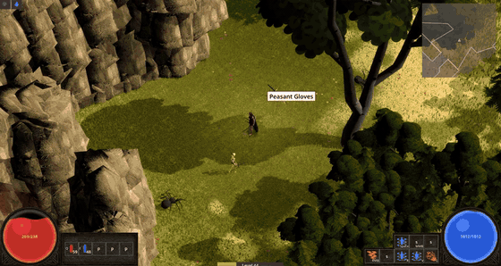
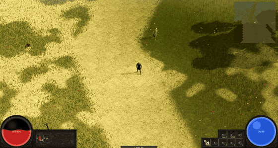
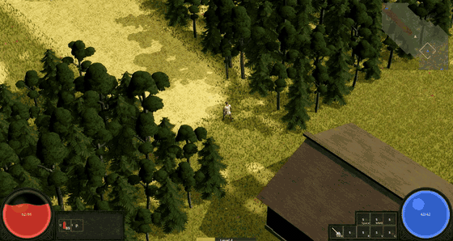
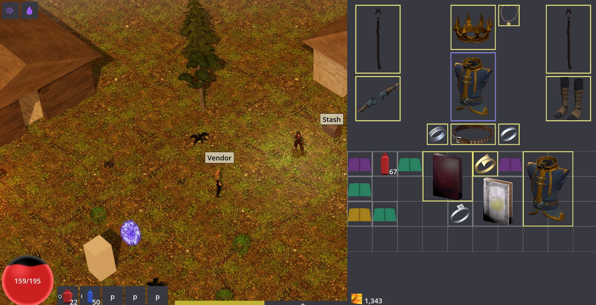
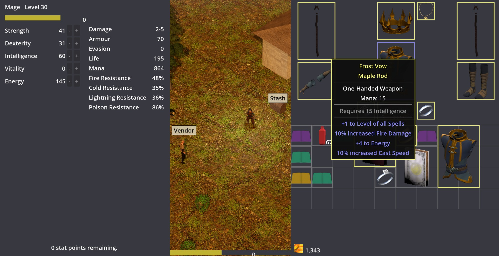
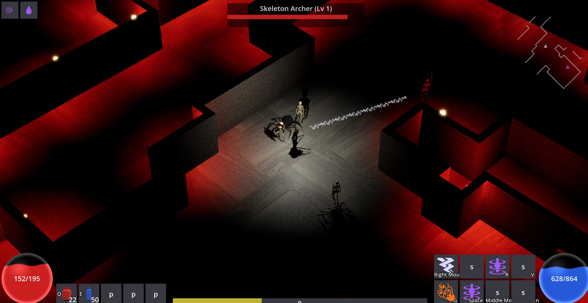
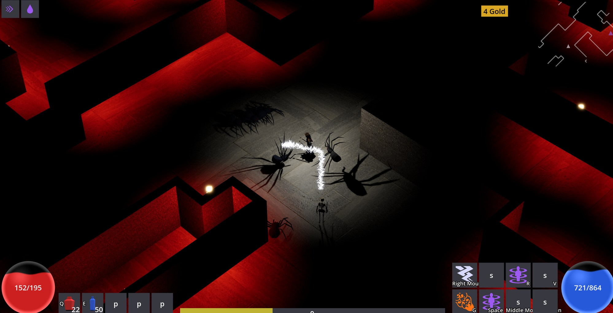

# ARPG devlog

I'm building an isometric action RPG in the Diablo II / Path of Exile lineage. Solo project,
written in C# on .NET with Godot 4 handling the rendering. The game's source is private for now,
so this repo is the public record of what it is and how it's put together.

| | |
|---|---|
|  |  |

## What's playable today

Character classes, click-to-move and WASD isometric combat, and a skill system where spells,
attacks, curses, buffs, and warcries combine through a socketed "page" system. Every attack
resolves through an accuracy-versus-evasion hit roll. Diablo-style loot with affix rolls, rarity
tiers, and identification. Monster packs with champion and rare ranks. A streaming multi-zone
overworld with towns, vendors, and a stash, plus saves, a full settings and keybinding shell,
mouse-wheel zoom, and every piece of player-facing text running through translatable string
tables. Characters are now full human bodies that wear their armour piece by piece, capes
included, and the first licensed environment kits are in. Most of the world is still placeholder
art. Systems come first, art passes later.

| | |
|---|---|
|  |  |
|  |  |

| | |
|---|---|
|  |  |

## How it's built

The core decision: the entire game simulation is a plain .NET library with no engine dependency.
Fixed-point math instead of floats, one seeded RNG, a fixed timestep, and every mutation flowing
through commands. Godot renders what the sim says and never touches it. The same seed produces a
byte-identical world on every run, and a suite of 9,000+ simulation tests enforces that. One of
them runs the whole game twice from the same seed and fails if the state hashes ever differ. The
full suite used to take 73 minutes; an optimized test build got it down to about 5.

Other things I care about:

- Headless verification. The real game boots without a window and asserts on the rendered world
  itself: geometry, collision lining up with visuals, draw call budgets, occlusion behavior.
  Visual changes ship with screenshots that a person actually looks at.
- A Lua extension system where the base game is itself the first mod. Items, damage types, stats,
  tags, monsters, affixes, vendors, and classes are all Lua prototype data loaded through a
  sandboxed interpreter, so adding a new damage type takes zero engine changes. The sandbox works
  by removing capability instead of scanning for abuse: no filesystem, no OS access, no wall
  clock, and Lua's built-in `math.random` is deleted outright so a mod can't smuggle
  nondeterminism into the sim.
- 230+ architecture decision records. The docs update in the same commit as the code they
  describe, so they never drift.
- Performance budgets as part of the design rather than an afterthought: pooled VFX, shared
  materials, capped dynamic lights, and harness checks that fail the build when a budget is
  blown.

## The AI workflow

This project doubles as my testbed for agentic development at scale. I design, direct, and review.
AI coding agents implement, test, and review each other's work in parallel git worktrees, and
every change passes independent code, QA, and architecture reviews plus the full test suite before
it merges. Reviewers break the code on purpose to prove each new test actually catches its bug.
About 850 pull requests have gone through that pipeline so far, all solo. I ran the same workflow
at my last job and my measured ticket throughput went up 4.1x.

## Status

In active development, heading toward a playable alpha. Currently in the works:

- Caves you walk straight into from the overworld, with rock walls that cut away when they'd hide
  your character.
- Streams cut into the terrain, with rock banks and gorges.
- Monster pathfinding on a shared flow field, so packs route around buildings instead of getting
  stuck.
- A passive tree pass: themed clusters, plus new stat types like conditional bonuses ("while
  holding a shield"), scaling per active warcry buff, and potion recovery.
- A loot rework that rolls drops as a decision tree (currency or gear, then jewellery, armour, or
  weapon, and so on), so adding more item variants never skews what drops.

More notes as systems land.

---
*Nathaniel Whittaker · [GitHub](https://github.com/nathanielwhittaker) ·
[LinkedIn](https://www.linkedin.com/in/nathaniel-whittaker-0b2863323/)*
