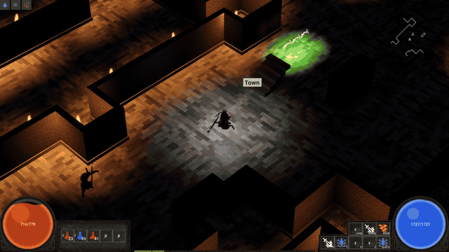
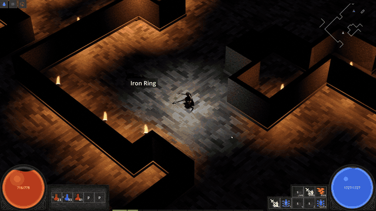
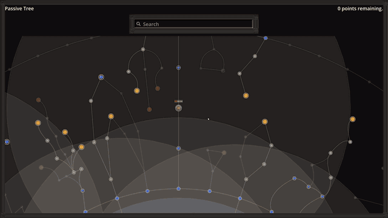
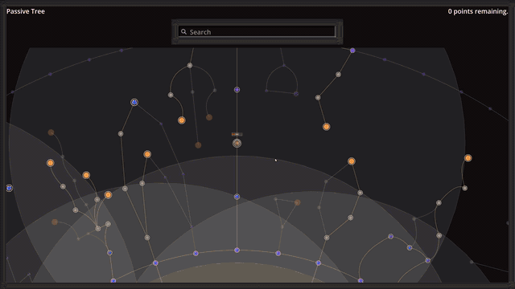
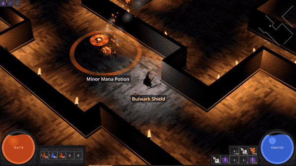

# ARPG devlog

I'm building an isometric action RPG in the Diablo II / Path of Exile lineage. Solo project,
written in C# on .NET with Godot 4 handling the rendering. The game's source is private for now,
so this repo is the public record of what it is and how it's put together.

| | |
|---|---|
|  |  |

## What's playable today

Character classes, click-to-move and WASD isometric combat, and a skill system where spells,
attacks, curses, buffs, and warcries combine through a socketed "page" system. Every attack
resolves through an accuracy-versus-evasion hit roll. Diablo-style loot with affix rolls, rarity
tiers, and identification. Monster packs with champion and rare ranks. A streaming multi-zone
overworld with towns, vendors, and a stash, an itemized map endgame, plus saves, a full settings and keybinding shell,
mouse-wheel zoom, and every piece of player-facing text running through translatable string
tables. Characters are now full human bodies that wear their armour piece by piece, capes
included, and the first licensed environment kits are in. Most of the world is still placeholder
art. Systems come first, art passes later.

| | |
|---|---|
|  |  |
|  |  |

| | |
|---|---|
|  |  |

## How it's built

The core decision: the entire game simulation is a plain .NET library with no engine dependency.
Fixed-point math instead of floats, one seeded RNG, a fixed timestep, and every mutation flowing
through commands. Godot renders what the sim says and never touches it. The same seed produces a
byte-identical world on every run, and a suite of 17,500+ simulation tests enforces that. One of
them runs the whole game twice from the same seed and fails if the state hashes ever differ. The
full suite used to take 73 minutes; an optimized test build got it down to about 5.

Other things I care about:

- Headless verification. The real game boots without a window and asserts on the rendered world
  itself: geometry, collision lining up with visuals, draw call budgets, occlusion behavior.
  Visual changes ship with screenshots that a person actually looks at.
- A Lua extension system where the base game is itself the first mod. Items, damage types, stats,
  tags, monsters, affixes, vendors, and classes are all Lua prototype data loaded through a
  sandboxed interpreter, so adding a new damage type takes zero engine changes. The sandbox works
  by removing capability instead of scanning for abuse: no filesystem, no OS access, no wall
  clock, and Lua's built-in `math.random` is deleted outright so a mod can't smuggle
  nondeterminism into the sim.
- 230+ architecture decision records. The docs update in the same commit as the code they
  describe, so they never drift.
- Performance budgets as part of the design rather than an afterthought: pooled VFX, shared
  materials, capped dynamic lights, and harness checks that fail the build when a budget is
  blown.

## The AI workflow

This project doubles as my testbed for agentic development at scale. I design, direct, and review.
AI coding agents implement, test, and review each other's work in parallel git worktrees, and
every change passes independent code, QA, and architecture reviews plus the full test suite before
it merges. Reviewers break the code on purpose to prove each new test actually catches its bug.
About 850 pull requests have gone through that pipeline so far, all solo. I ran the same workflow
at my last job and my measured ticket throughput went up 4.1x.

## 16-23 October 2026: patch 0.2.0, the second alpha build

Patch 0.2.0, the second alpha build, is ready. It covers everything since the 0.1.0 build on 16
October:

- Maps, the first endgame. A map is an item that stores a zone and an area level (1, then 5 to 80
  in steps of 5). You place it in the town Map Device to open a portal into a generated run.
  Dungeon maps use the dungeon layout; Cave maps are carved mazes of about 150 monsters. Kills
  inside a run drop more maps, about 3.5 per full clear on average, so a run can sustain the next
  one. The vendor has a Maps tab that always sells tier 1 Dungeon and Cave maps, plus one of each
  near your level.
- Inscriptions rebuilt from scratch. The two old ones are gone and eight new ones cover every gear
  slot. Some of them grant an aura that costs nothing and stays on while the item is equipped. An
  aura never stacks with a cast of the same buff; the higher level wins.
- Attack skills. Every class now starts with a dagger and a Basic Attack that adapts to the
  equipped weapon. Combat and Marksman Manuals grant attacks the same way spell books grant
  spells. The first two are Arrowfall, a bow volley that rains 12 arrows on the aim point, and
  Leap Slam, which hits and stuns everything around the landing. Weapon attacks can now crit at a
  150% base multiplier; spells still never do. Spells and ranged attacks no longer root you (more
  on that below).
- Items to item level 80. Every weapon, armour, shield, belt and crown line gets new tiers up to
  item level 80. Weapon base damage is cut from item level 25 up (item level 34-80 bases now deal
  70% of their old damage), and the flat damage prefixes on weapons are rescaled.
- A passive tree pass of about 120 new nodes across all three attributes, plus a search box that
  highlights every matching node.
- Smaller things: walk-in maze caves, ravine streams with plank bridges, graphics presets, a
  three-tab character sheet, and a long list of fixes.

On the engineering side the approach didn't change. All of it runs on the same deterministic,
fixed-point sim, and it went through the same agent workflow: test-first lanes that write a
failing test before the code, and cold code reviews where the reviewer sees only the diff and the
requirements, not the reasoning behind them. The sim suite is now at about 17,500 tests.

## How the spell system works

Spells don't come from gear. A spell comes from a book, and you socket the book into a Skill Socket
node on the passive tree. The spell's level is the number of allocated passives within that
socket's radius, capped at 20, so where you put the book and how you path the tree around it is
the main build decision. A respec re-levels the spell straight away, and "+ to Level" stats on gear
and notables can push it past 20.

Pages are the support layer. A book has page slots; you open it and drop pages in, and each one
changes how the spell is delivered or what it does. A conversion page turns the spell's elemental
damage into one element. Chaining makes each hit jump on to the nearest new enemy. Volley adds
projectiles, and a beam fires them side by side. Projectile Nova fires the spell as a ring around
you, Spiral sends one projectile spiralling outward, and Beam turns it into a beam. Meteor and
Shards replace the delivery outright, so the spell falls from the sky as one big strike or a shower
of shards. Pages apply in slot order, so every combination has a defined result, and they cost no
mana.

Pages can be swapped at any time, including while the book sits in the tree, and the tooltip always
shows what the spell will do with the pages it has now. The same book can be a chaining fire beam
one minute and a meteor the next.

*A lightning beam converted to fire, with the Chaining and Volley pages.*

*Moving pages in and out of the socketed book on the passive tree, then casting the changed spell.*

| | |
|---|---|
|  |  |
| *Page of Shards: the spell rains down as a shard shower.* | *Page of Meteor: the spell drops as meteors.* |

*Page of Projectile Nova: the spell fires in a ring.*

## Attacking and casting while moving

Spells and ranged attacks no longer root you. You keep moving at half speed while you cast or
shoot, and warcries work on the move too. The character always faces the cursor: the torso aims
while the legs walk wherever you're actually going. The default gait is a jog, which drops to a
walk while a skill is in use. Melee attacks still root you, because a swing lands from the spot
where it started.

Before this, every fireball stopped you dead, which fought the way a ranged build wants to play.
Kiting, backing away from a pack while firing into it, is most of how a caster or an archer
survives, and now it works. I want combat to feel snappy, not floaty, and splitting movement from
aiming means the character answers both inputs at once instead of planting, turning, and then
acting.

## Status

In active development; patch 0.2.0, the second alpha build, is ready. Currently in the works:

- Monster pathfinding on a shared flow field, so packs route around buildings instead of getting
  stuck.
- A loot rework that rolls drops as a decision tree (currency or gear, then jewellery, armour, or
  weapon, and so on), so adding more item variants never skews what drops.

More notes as systems land.

---
*Nathaniel Whittaker · [GitHub](https://github.com/nathanielwhittaker) ·
[LinkedIn](https://www.linkedin.com/in/nathaniel-whittaker-0b2863323/)*
