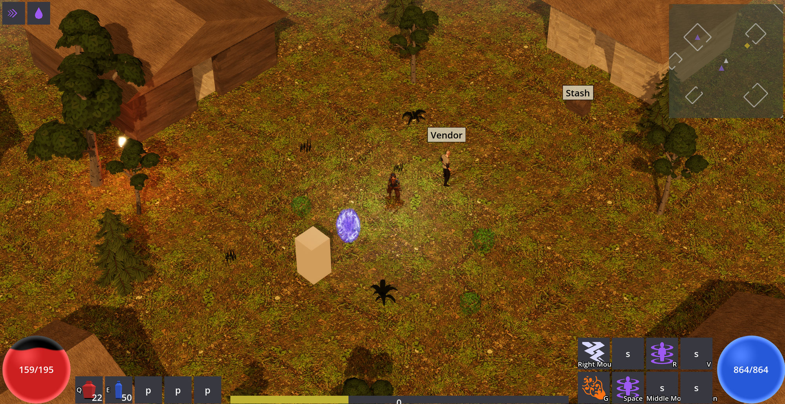

# ARPG devlog

I'm building an isometric action RPG in the Diablo II / Path of Exile lineage. Solo project,
written in C# on .NET with Godot 4 handling the rendering. The game's source is private for now,
so this repo is the public record of what it is and how it's put together.

## What's playable today

Character classes, click-to-move and WASD isometric combat, and a skill system where spells,
attacks, curses, and buffs combine through a socketed "page" system. Diablo-style loot with affix
rolls, rarity tiers, and identification. Monster packs with champion and rare ranks. A streaming
multi-zone overworld with towns, vendors, and a stash, plus saves and a full settings and
keybinding shell. All of it runs on placeholder art. Systems come first, art passes later.

| | |
|---|---|
|  |  |

## How it's built

The core decision: the entire game simulation is a plain .NET library with no engine dependency.
Fixed-point math instead of floats, one seeded RNG, a fixed timestep, and every mutation flowing
through commands. Godot renders what the sim says and never touches it. The same seed produces a
byte-identical world on every run, and a suite of 4,600+ tests enforces that. One of them runs the
whole game twice from the same seed and fails if the state hashes ever differ.

Other things I care about:

- Headless verification. The real game boots without a window and asserts on the rendered world
  itself: geometry, collision lining up with visuals, draw call budgets, occlusion behavior.
  Visual changes ship with screenshots that a person actually looks at.
- A Lua extension system where the base game is itself the first mod. Items, damage types, stats,
  tags, monsters, affixes, vendors, and classes are all Lua prototype data loaded through a
  sandboxed interpreter, so adding a new damage type takes zero engine changes. The sandbox works
  by removing capability instead of scanning for abuse: no filesystem, no OS access, no wall
  clock, and Lua's built-in `math.random` is deleted outright so a mod can't smuggle
  nondeterminism into the sim.
- 170+ architecture decision records. The docs update in the same commit as the code they
  describe, so they never drift.
- Performance budgets as part of the design rather than an afterthought: pooled VFX, shared
  materials, capped dynamic lights, and harness checks that fail the build when a budget is
  blown.

## The AI workflow

This project doubles as my testbed for agentic development at scale. I design, direct, and review.
AI coding agents implement, test, and review each other's work in parallel git worktrees, and
every change passes independent code, QA, and architecture reviews plus the full test suite before
it merges. About 500 pull requests have gone through that pipeline so far, all solo. I ran the
same workflow at my last job and my measured ticket throughput went up 4.1x.

## Status

In active development, heading toward a playable alpha. More notes as systems land.

---
*Nathaniel Whittaker · [GitHub](https://github.com/nathanielwhittaker) ·
[LinkedIn](https://www.linkedin.com/in/nathaniel-whittaker-0b2863323/)*
