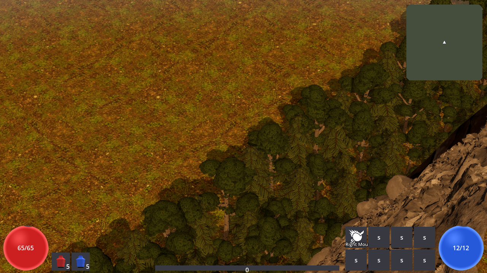
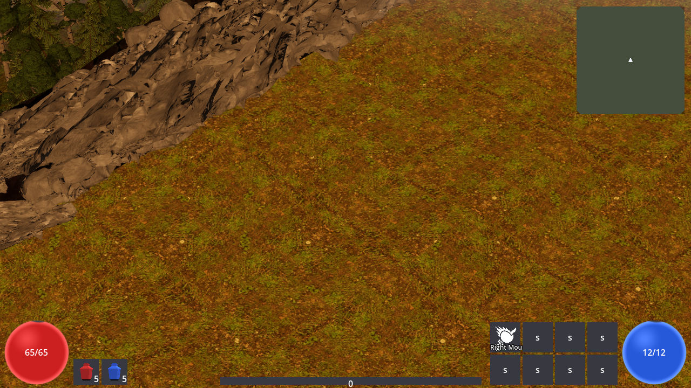
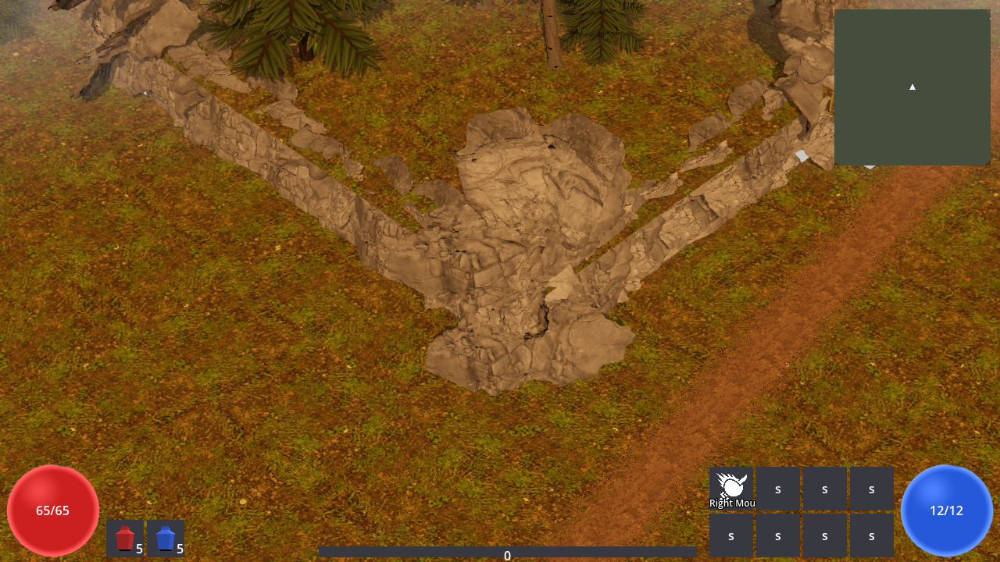
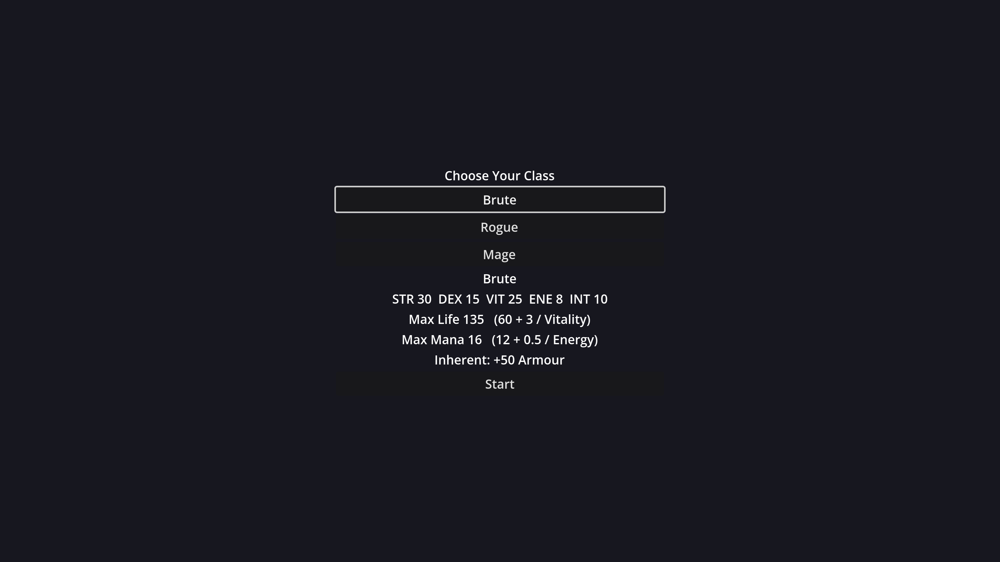

# ARPG — solo-built action RPG (devlog)

A pre-alpha isometric action RPG in the Diablo II / Path of Exile lineage, built solo in **C# / .NET**
with a **Godot 4** front end. The game's source is private; this repo is the public record of what it
is and how it's engineered.

## What exists today (pre-alpha)

Playable end to end: character classes, click-to-move / WASD isometric combat, a growing skill
system (spells, attacks, curses, buffs/auras — composable via a socketed "page" system), Diablo-style
itemization (affix rolls, rarity tiers, identification, gear slots), monster packs with champion /
rare ranks, multi-zone streaming overworld with towns, vendors, stash, waypoints-in-progress, saves,
and a settings/keybinding shell. Placeholder art throughout — systems first, art passes later.

| | |
|---|---|
|  |  |

## How it's engineered (the part I'm proudest of)

- **Deterministic simulation core, cleanly split from the renderer.** The entire game simulation is a
  pure .NET library with no engine dependency: fixed-point math (Q32.32, no floats), one seeded
  counter-based RNG, fixed timestep, and mutation only through commands. The Godot layer renders the
  sim and never mutates it. Same seed → byte-identical world, every run.
- **4,600+ automated tests**, including a run-twice determinism oracle (two full runs from the same
  seed must produce identical state hashes) that has gated every merge since the engine's first month.
- **Headless verification harnesses** boot the real game without a window and assert on the actual
  rendered world — geometry, collision-vs-visual coincidence, draw-call budgets, occlusion behavior —
  with screenshot capture for human review. Visual work ships with rendered proof, not "looks right."
- **Architecture Decision Records**: 170+ ADRs document every load-bearing decision; docs and code
  are updated in the same change, never allowed to drift.
- **Performance as a design constraint**: pooled VFX, shared materials, budgeted dynamic lights,
  off-screen gating — perf-relevant changes ship with harness guards that assert the budget.

## The AI-agent workflow

The interesting meta-story: this project is also my testbed for **agentic development at scale**. I
design, direct, and review; fleets of AI coding agents implement, test, and cross-review in parallel
worktrees — each change runs a gauntlet of independent cold reviews (code, QA/regression, architecture)
plus the full test suite and headless verifies before merge. Roughly **500 merged pull requests** and
a tracker of 1,600+ issues have flowed through this pipeline solo. The same workflow, applied to my
day job, roughly quadrupled my measured ticket throughput.

## Status

Actively developed, targeting a playable alpha. This devlog will grow as systems land.

---
*Nathaniel Whittaker — [GitHub](https://github.com/nathanielwhittaker) ·
[LinkedIn](https://www.linkedin.com/in/nathaniel-whittaker-0b2863323/)*
